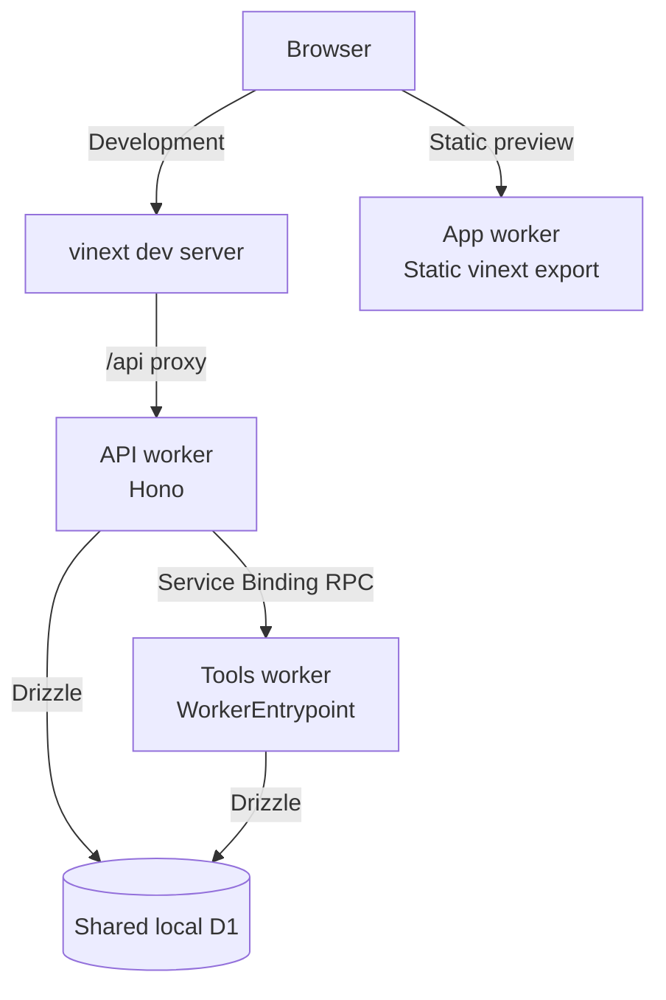

# Voice Freight Broker

Browser-based voice freight brokerage simulation using synthetic carriers and
loads. The intended experience is a carrier sales conversation followed by an
inspectable dashboard record.

## Getting started

Open the repository in its devcontainer, or run the setup script:

```sh
bash scripts/setup.sh
```

Follow the script's instruction to load Vite+, then start development:

```sh
vp run dev
```

For isolated component development, run `vp run storybook` in another terminal.
Use `vp run` without a task name to discover the other workspace tasks.

Local scaffolding runs without Cloudflare or OpenAI credentials. The
[setup script](scripts/setup.sh) documents installation details; package
manifests and the lockfile own dependency versions.

## Development notes

The frontend is intended to remain a static export. Backend behavior belongs in
the Workers, with shared business logic kept outside the HTTP and RPC adapters.
Browser-safe contracts are separate from private backend code.

Static preview requires a build first and serves only the exported frontend. Use
the development server when working with the API proxy. Storybook has a separate
Vite configuration because its client renderer must not load vinext's
server-component plugins.

Browser integration checks manage their own servers; stop any existing Storybook
or static preview process before running them. These checks validate the
scaffold, not live audio or hosted authentication.

See the [CI workflow](.github/workflows/checks.yml) for the validation sequence
and [AGENTS.md](AGENTS.md) for contributor conventions.

[prd]: https://chatgpt.com/space/page_4da0fc95119881919f400a7d37c9181c

## Architecture

The current scaffold supports local development and static frontend preview:



API and Tools import the same backend package and Zod contracts. The RPC path
currently exercises the health probe; voice coordination, authentication, and
post-call processing are defined in the [PRD][prd] and remain to be implemented.
