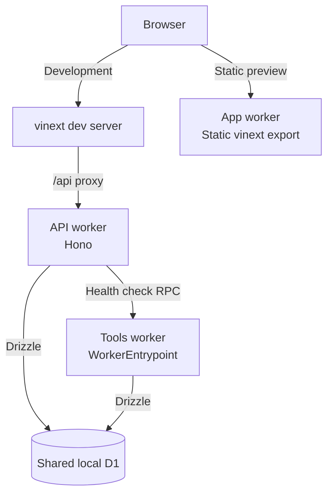

# Voice Freight Broker

Browser-based freight brokerage simulation with synthetic carriers and loads.
The dashboard, local accounts, and business engine are implemented. Live voice,
hosted authentication, and analysis processing are planned in the [PRD][prd].

## Getting started

Open the repository in its devcontainer, or run the setup script:

```sh
bash scripts/setup.sh
```

Follow the script's instruction to load Vite+, then apply migrations and start
the frontend, API, and Tools workers:

```sh
vpr db:migrate
vpr dev
```

Open <http://localhost:3000/dashboard>. **Sign in** offers Local Reviewer,
Second Reviewer, and Local Administrator. Sign-in creates the selected account.
Reviewers see their own call records; administrators see all records and can
**Restock inventory** to populate or replenish inventory. The dashboard includes
public samples alongside calls your account can access. Private history starts
empty; the UI cannot start voice sessions yet.

Use desktop Chrome for local sign-in. Overlapping account changes are blocked.

For frontend-only development, use `vpr dev:web`; bundled samples work without
the API. Use `vpr storybook` to develop components in isolation. Use `vpr`
without a task name to discover the other workspace tasks.

## Development notes

The frontend remains a static export. Run `vpr build` before `vpr preview`;
preview serves only the exported frontend. Use `vpr dev` for the API proxy.

UI components use shadcn's `base-nova` preset with Base UI primitives. Storybook
uses a separate Vite configuration to keep vinext's server-component plugins out
of its client renderer.

Run `vpr check`, `vpr build`, `vpr build:storybook`, `vpr test`, and
`vpr test:browser` for validation. Browser checks manage their own servers; stop
existing Storybook/static previews first.

Browser tests default to two parallel workers. Identity tests give each worker
its own local API/Tools runtime and D1 database, reset storage between tests,
and apply migrations before the next test. Playwright builds the local test
Workers once at startup. These tests use a private browser proxy and do not use
the database from `vpr dev`. Runtime scratch directories stay under the ignored
`.local` directory and are removed after each run.

To compare a single-worker run, use `pnpm exec playwright test --workers=1`.

See the [CI workflow](.github/workflows/checks.yml) for the validation sequence
and [AGENTS.md](AGENTS.md) for contributor conventions.

## Architecture



API REST routes and Tools RPC methods call shared backend handlers directly.
Business logic stays outside the adapters; browser-safe Zod contracts stay
separate from private backend code. Both Workers share the same local D1
database. The API currently calls Tools RPC only for its health check.

See [business engine notes](docs/business.md) for fixtures, negotiation rules,
confirmation, reporting, and persistence.

[prd]: https://chatgpt.com/space/page_4da0fc95119881919f400a7d37c9181c
