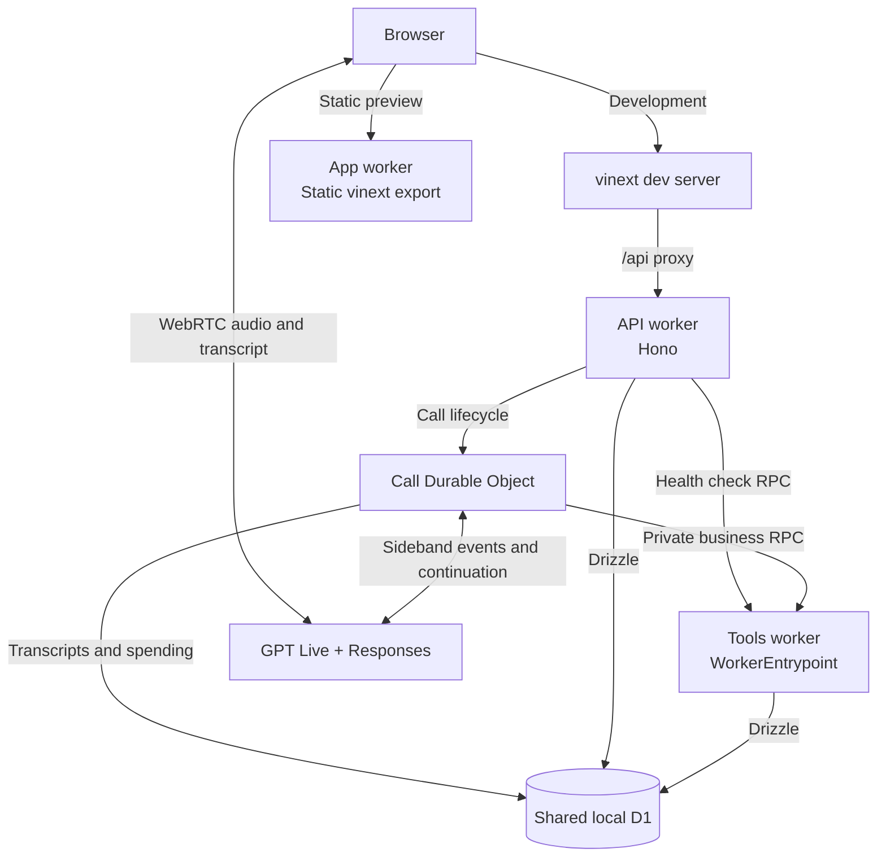

# Voice Freight Broker

Browser-based freight brokerage simulation with synthetic carriers and loads. Live calls use GPT Live with Responses
delegation and the shared business engine. Hosted authentication and analysis processing remain planned in the
[PRD][prd].

## Getting started

Open the repository in its devcontainer, or run the setup script:

```sh
bash scripts/setup.sh
```

Follow the script's instruction to load Vite+, then apply migrations and start the frontend, API, and Tools workers:

```sh
vpr db:migrate
vpr dev
```

Open <http://localhost:3000/dashboard>. **Sign in** offers Local Reviewer, Second Reviewer, and Local Administrator.
Sign-in creates the selected account. Reviewers see their own call records; administrators see all records and can
**Restock inventory** to populate or replenish inventory. The dashboard includes public samples alongside calls your
account can access. Private history starts empty. For voice, add `OPENAI_API_KEY` to the ignored
`apps/api/.dev.vars.local`, restart the Workers, and open <http://localhost:3000/call>. Use **Start call**, allow the
microphone, and give one of the displayed demo MC numbers. Voice uses `gpt-live-1`; delegation uses `gpt-6-luna` with
low reasoning effort. Both require model access.

Loads are introduced one at a time by route, dates, equipment, cargo, weight, mileage, and posted rate. Ask for the full
reference if you need it.

After the carrier, route, equipment, pickup date, and exact rate are read back, say **Yes, confirmed**. Normal pauses do
not invalidate the read-back. Agreements, cancellations, and replacements require fresh confirmation. Hang up to inspect
the saved transcript, rates, and agreements in the dashboard. Analysis stays pending until its processing phase is
implemented. Voice validation targets desktop Chrome; other browsers and mobile audio have not been validated.

Use desktop Chrome for local sign-in. Overlapping account changes are blocked. If a port-forwarded browser address
causes a same-origin error, set `LOCAL_ALLOWED_ORIGIN` in `apps/api/.dev.vars.local` to the exact browser origin, for
example `http://localhost:49245`, and restart the workers. Update it if the forwarded address changes. This setting
applies only to local auth.

Live calls share a **$25 USD monthly app allowance**, renewing at 00:00 UTC on the first day. The app reserves
approximately $5.20 before a call and releases unused money after confirmed final usage. Duration is limited to ten
minutes; 60 seconds without caller speech ends a call, with a warning 15 seconds before. Defaults allow one concurrent
call per reviewer/two globally and six daily calls per reviewer/40 globally, resetting at 00:00 UTC.

The ledger counts server-observed voice and delegated usage in integer USD microdollars. Reports and shutdown can lag;
outstanding work may finish during closure, so this guardrail can overshoot. It is not an exact provider billing cap and
does not cover API-key use outside this app. Uncertain usage retains its reservation. Preserve this ledger when moving
to hosting; concurrent local and hosted paid sessions must use one authoritative ledger.

For repeated local testing, `apps/api/.dev.vars.local` also accepts `REVIEWER_DAILY_CALLS`, `GLOBAL_DAILY_CALLS`,
`REVIEWER_CONCURRENT_CALLS`, `GLOBAL_CONCURRENT_CALLS`, `CALL_DURATION_SECONDS`, and `CALL_INACTIVITY_SECONDS`. Changes
apply to new calls. They do not increase the $25 monthly allowance. Model prices and reservation bounds are versioned in
`packages/backend/src/spending.ts`; prompts are versioned in `apps/api/src/live-configuration.ts`.

## Simulated voice and budget checks

Keep `vpr dev:web` running and stop the normal API Worker before starting a fixture:

```sh
bash scripts/start-stub.sh workflow
```

The script applies migrations and starts both Workers. Each scenario uses an isolated local database and never sends
paid requests. Sign in as Local Administrator on the dashboard and **Restock inventory**, then sign out and sign in as
Local Reviewer on `/call`.

- `workflow`: start a call. An accelerated scripted conversation creates two agreements, cancels one, and replaces the
  other. Mute/unmute, hang up, then inspect both loads and their agreement history in the dashboard.
- `budget-start`: starting explains insufficient allowance and its renewal.
- `budget-active`: starting connects, then ends with an allowance message.

Switch scenarios by stopping the script and running it again with the desired name. Scenario histories persist
separately under `.wrangler/stub-*`.

For frontend-only development, use `vpr dev:web`; bundled samples work without the API. Use `vpr storybook` to develop
components in isolation. Use `vpr` without a task name to discover the other workspace tasks.

## Development notes

Dependency installation sets up a pre-commit hook that formats and lints staged files. Check its status with
`pnpm exec vp hooks status`; run `pnpm exec vp hooks enable` to enable it in an existing checkout.

The frontend remains a static export. Run `vpr build` before `vpr preview`; preview serves only the exported frontend.
Use `vpr dev` for the API proxy.

UI components use shadcn's `base-nova` preset with Base UI primitives. Storybook uses a separate Vite configuration to
keep vinext's server-component plugins out of its client renderer.

Run `vpr check`, `vpr build`, `vpr build:storybook`, `vpr test`, and `vpr test:browser` for validation. Browser checks
manage their own servers; stop existing Storybook/static previews first.

Browser tests build and serve the compiled frontend for both the `public` and `integration` projects; they do not start
the frontend development server. Storybook checks use its separate development server.

Browser tests default to two parallel workers. Identity and voice tests give each worker its own local API/Tools runtime
and D1 database, reset storage between tests, and apply migrations before the next test. Playwright builds the local
test Workers once at startup. These tests use a private browser proxy and do not use the database from `vpr dev`. Voice
is stubbed and provider credentials are unnecessary. Runtime scratch directories stay under the ignored `.local`
directory and are removed after each run.

To compare a single-worker run, use `pnpm exec playwright test --workers=1`.

See the [CI workflow](.github/workflows/checks.yml) for the validation sequence and [AGENTS.md](AGENTS.md) for
contributor conventions.

## Architecture



API REST routes and Tools RPC methods call shared backend handlers directly. Business logic stays outside the adapters;
browser-safe Zod contracts stay separate from private backend code. Both Workers share the same local D1 database. Each
call's Durable Object owns tool execution and continuation; browser event permissions exclude those actions. Final
agreement snapshots remain immutable while final transcript and usage events drain.

See [business engine notes](docs/business.md) for fixtures, negotiation rules, confirmation, reporting, and persistence.

[prd]: https://chatgpt.com/space/page_4da0fc95119881919f400a7d37c9181c
