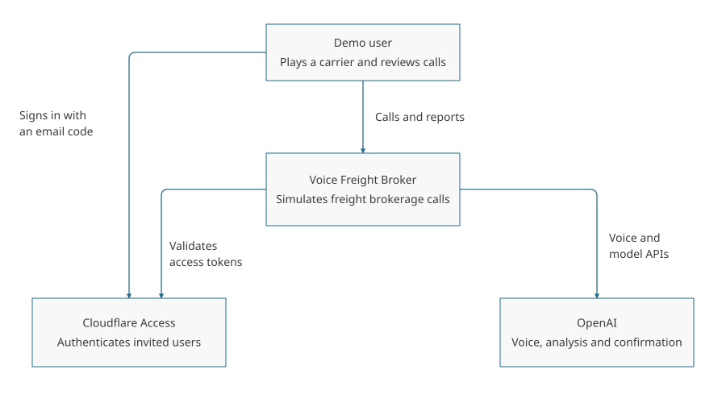
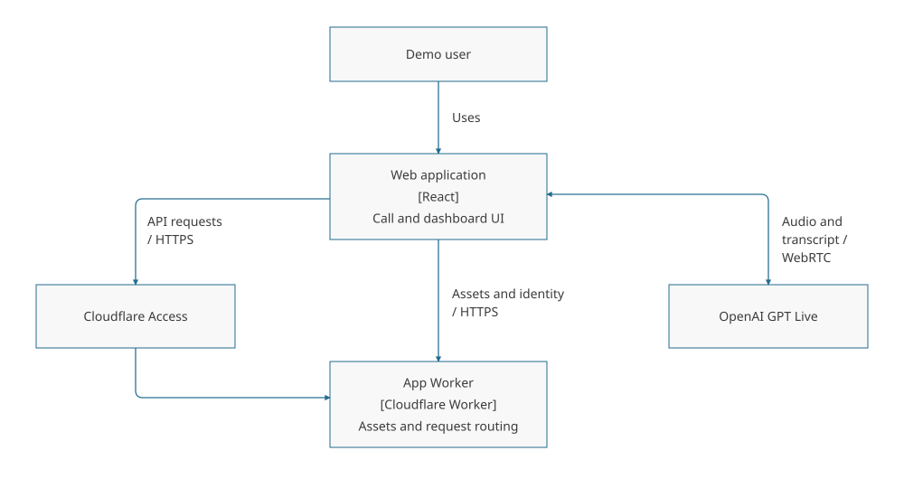
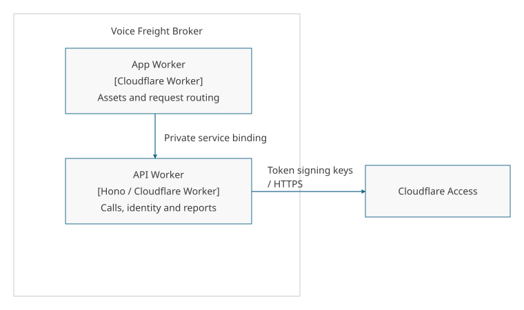
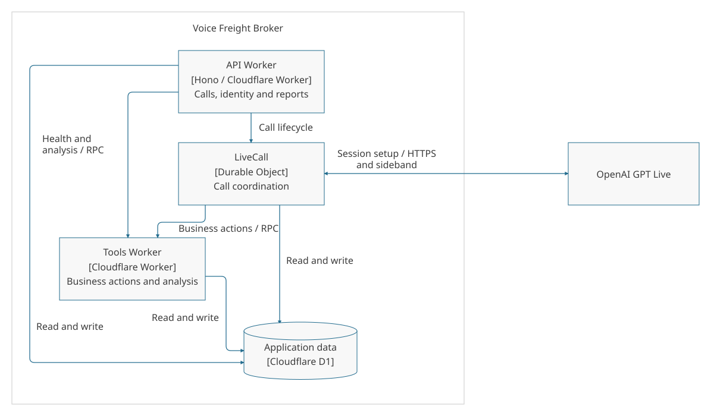
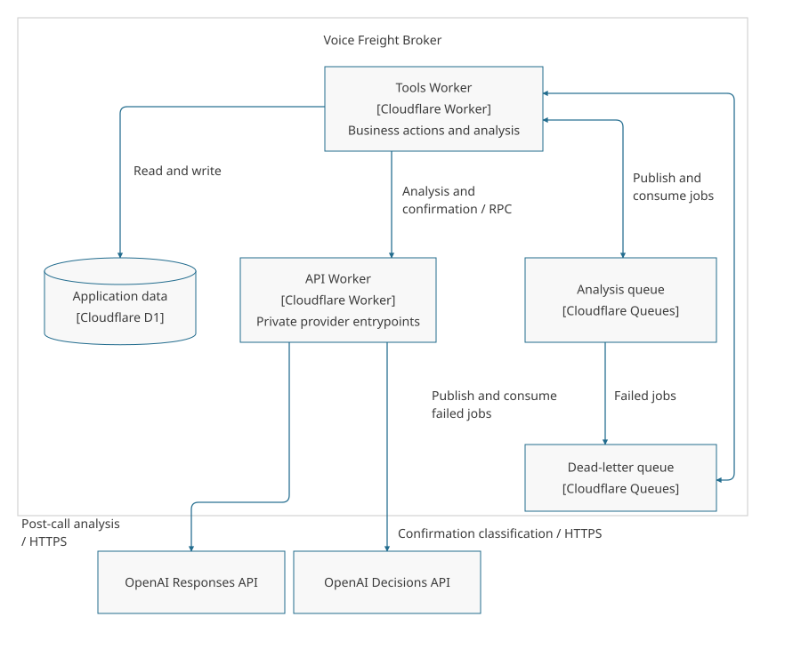

# Voice Freight Broker

Browser-based freight brokerage simulation with voice calls using GPT Live

> 🔊 Unmute video for voice

https://github.com/user-attachments/assets/b26da6e1-3399-4449-b9df-2c2da077cac4

## Development

Start a [devcontainer](https://containers.dev/supporting), or a
[codespace](https://docs.github.com/en/codespaces/quickstart), or run the setup script:

```sh
bash scripts/setup.sh
```

Add your API keys to `apps/api/.dev.vars.local`.

Then apply migrations and start the dev servers:

```sh
vpr db:migrate
vpr dev
```

Open the web app at <http://localhost:3000>.

To reset the local database, stop the dev servers and run `vpr dev:reset:db`. This deletes local D1 data and reapplies
the migrations.

For evaluations, see [evals/README.md](evals/README.md).

Use the CLI for local development and commands for administering the deployment:

```sh
pnpm --silent cli --help
pnpm --silent cli calls transcript <call-id> --json
pnpm --silent cli db schema --json
pnpm --silent cli dev limits reset --json
pnpm --silent cli eval --suite confirmations dallas-fragmented --json
pnpm --silent cli deployed roles sync --json
```

`calls` and `db` inspect local storage read-only without running Workers or credentials. Their `--database` and
`--persist-to` options select storage. `dev limits reset` requires local Workers and resets all users' daily call quotas
while preserving history, spending, and active-call checks. `eval` makes paid requests using the existing provider key
and shared allowance. With `--json`, results go to stdout and errors or progress go to stderr.

## Production deployment

Use Terraform for production infrastructure and releases. The `deployed roles sync` CLI command synchronizes application
roles from applied Terraform state. See [production deployment](infrastructure/README.md) for setup, credentials,
deployment, and recovery.

## Architecture

<!-- C4 Model -->



### Live calls and dashboard

The web application runs in the user's browser. The App worker ([Cloudflare Worker]) serves it using [Static Assets],
and [Cloudflare Access] protects API requests. The browser connects directly to [OpenAI GPT Live] for call audio and
live transcripts.



The App worker forwards requests to the API worker over a private [service binding]. The API worker validates Access
tokens using Cloudflare's signing keys and checks user permissions against [Cloudflare D1].



The API worker coordinates calls and reads application data. LiveCall, a [Durable Object], manages individual calls and
invokes the Tools worker for business actions. All three read and write D1; LiveCall also connects to GPT Live for
session setup and [sideband events].



### Analysis and confirmation

The Tools worker publishes and consumes analysis jobs using [Cloudflare Queues] and handles failed jobs. It calls
private entrypoints on the API worker for both post-call analysis and confirmation classification. These entrypoints
hold the OpenAI credential.



[Cloudflare Worker]: https://www.cloudflare.com/products/workers
[Cloudflare Access]: https://www.cloudflare.com/products/access
[OpenAI GPT Live]: https://developers.openai.com/api/docs/guides/live
[service binding]: https://developers.cloudflare.com/workers/runtime-apis/bindings/service-bindings/
[Cloudflare D1]: https://developers.cloudflare.com/d1/
[Durable Object]: https://developers.cloudflare.com/durable-objects/
[sideband events]: https://developers.openai.com/api/docs/guides/voice-server-controls
[Cloudflare Queues]: https://developers.cloudflare.com/queues/
[Static Assets]: https://developers.cloudflare.com/workers/static-assets
