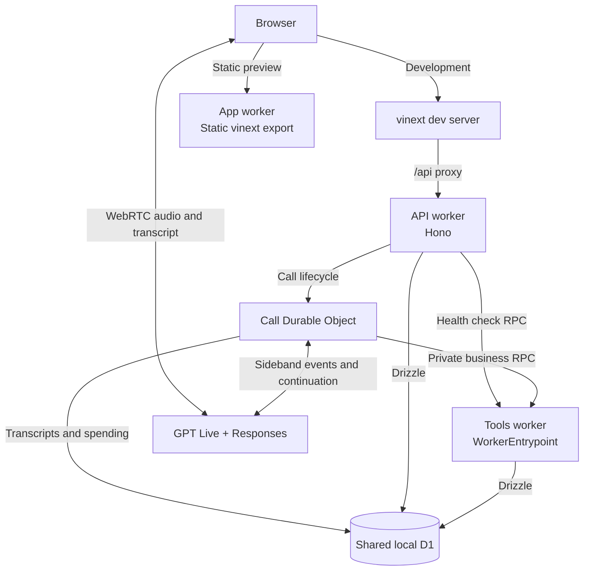

# Voice Freight Broker

Browser-based freight brokerage simulation with voice calls using GPT Live

## Getting started

Build a devcontainer, or run the setup script:

```sh
bash scripts/setup.sh
```

Add your API keys to `apps/api/.dev.vars.local`.

Then apply migrations and start the dev servers:

```sh
vpr db:migrate
vpr dev
```

Open <http://localhost:3000>

## Architecture


